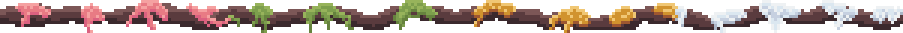
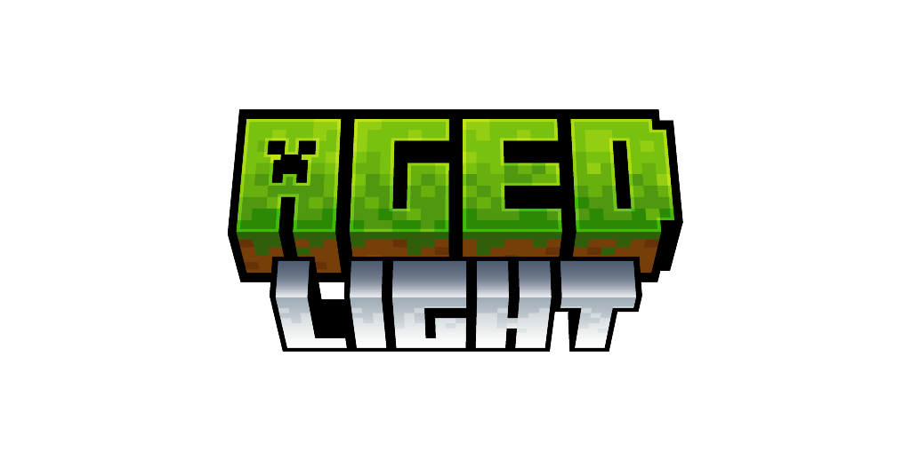
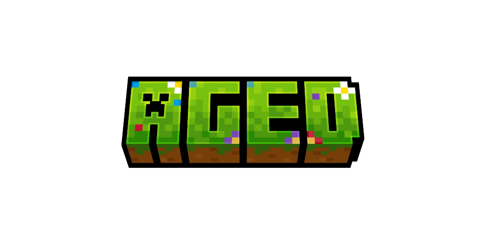

*A challenging medieval based modpack where realism & wisdom rule your life.*

You awaken in the wilderness.
You quickly realize that you need to **gather supplies** & craft some **flint tools**.
**Fresh water** and **body temperature** become important pretty soon.
Your **character** is still weak, so you go an adventure to **gather experience** to increase your **skills and attributes**.

*That's where your story begins.*

<strong>
Features
</strong>

- 💧 **Hydration** - boil water to receive purified water that you can safely consume
- 🍖 **Nutrition** - eat a balanced diet, but don't eat spoiled dishes
- ❄️ **Temperature** - keep yourself cozy in all areas
- 🌍 **Seasons** - prepare for winter & check your crops
- 🧮 **Skills** - gather xp to improve your characters aspects
- 🛠️ **Jobs** - assign up to 2 jobs to receive xp faster
- 🏡 **Settle** - explore & protect your goods against enemy forces
- 🪙 **Trade** - you'll stumple upon more wandering traders & other traders
- ⚔️ **Fight** - mobs get stronger the further you go. At the same time they offer more loot
- ♟️ **Bosses** - more than 6 unique boss fights to defeat
- 🎒 **Backpacks** - store goods in drawers or use portable backpacks
- 📦 **Sieve** - filter items trough sieves to get common to rare items
- 🪑 **Furniture** - decorate your home with a variety of furniture blocks
- 🦖 **Archeology** - reveal ancient fossils & powerful enchantments
- ✨ **Decorate** - various blocks to decorate with

<strong>
Different Versions
</strong>

You're most likely asking yourself what the differences between [Aged Light](https://modrinth.com/modpack/aged-light) & [Aged](https://modrinth.com/modpack/aged) are.  
**Aged Light is a lightweight version of Aged with close to 0 aesthetic & visual mods.**  

Since Aged v3.1.0 both modpacks are compatible with each other.  
Take a look at the [Aged Light Changelog](https://github.com/xR4YM0ND/Aged-Light/blob/1.21.1/CHANGELOG.md) to know which Aged version its compatible with.  

  
  

Aged also includes all datapacks, resourcepacks and config files from [aged light](https://github.com/xR4YM0ND/Aged-Light/tree/1.21.1) besides *default options config*.  
In this repo you will only see files specific to aged (mostly client side enhancements).

Mods which are in Aged

- all of Aged Light
- [ETF] Entity Texture Features
- [EMF] Entity Model Features
- [ESF] Entity Sound Features
- 3D Skin Layers
- AsyncParticles
- Blur+
- Camera Overhaul
- Chat Animation [Smooth Chat]
- Chat Heads
- Cherished Worlds
- Continuity
- Distant Horizons
- Fancy Menu
- First-person Model
- Immersive UI
- ImmersiveThunder
- Iris Shaders
- Konkrete `// needed for Fancy Menu`
- Melody `// needed for Fancy Menu`
- MidnightLib `// needed for Blur+`
- Model Gap Fix
- MRU `// needed for Sounds`
- Not Enough Animations `// needed for First-person Model`
- Particle Effects
- Particle Rain
- Particular
- Presence Footsteps
- Satin Free Wakes
- ShatterLib | OctoLib `// needed for Immersive UI`
- Smooth Scrolling Refurbished
- Smooth Swapping
- Soft Imprints
- Sound Physics Remastered
- Sounds
- Status Effect Bars
- Sublte Effects
- Visuality

<strong>
FAQ
</strong>

> **Q: Does Aged support multiplayer?**
>
> **A**: Yes and No, Aged is build for singleplayer since v3.0.0 but can be downloaded as server file via e.g. [ATLauncher](https://atlauncher.com/downloads) / [mrpack-install](https://github.com/nothub/mrpack-install#readme) / [docker](https://github.com/itzg/docker-minecraft-server).
>
> If you want to play with a friend we recommend to use [e4mc](https://modrinth.com/mod/e4mc) to create a server for free.

> **Q: Is there a wiki or documentation?**
>
> **A**: Ingame you'll find a guide book at first start.  
> Combine a  book with a sapling/seed or use `/give @s agedaddition:guide_book`

> **Q: Where to ask for help / bug report?**
>
> **A**: For **questions** ask in `modpack-chat` on our [Discord](https://discord.gg/WXdSYn4yHB). For **bugs** pls open a [github issue](https://github.com/xR4YM0ND/Aged-Light/issues).

<strong>
Known Bugs
</strong>

> **To be filled**
>
> New verison 4.0.0 -> waiting for your feedback ^^
